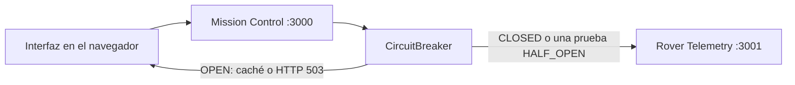

# MarsGuard — Mission Control Resilience Lab

Prueba de concepto de Arquitectura de Software. Dos servicios HTTP independientes se comunican bajo un Circuit Breaker implementado en el proyecto, sin librerías que resuelvan el patrón.

## 1. Descripción de la prueba

El Circuit Breaker es un patrón de resiliencia. Un componente deja de llamar a una dependencia cuando esta acumula fallos, responde con una alternativa controlada y, más tarde, comprueba si la dependencia volvió a funcionar. La finalidad es evitar que un servicio lento o caído consuma hilos, tiempo de espera y la atención de quien opera el sistema.

MarsGuard representa el centro de control de la misión ARES-01. Los operadores consultan la telemetría de un rover: batería, temperatura exterior, señal, velocidad, coordenadas simuladas, estado de los sistemas y hora de la última transmisión. Esa consulta no va directo al rover. La interfaz habla solo con Mission Control (`http://localhost:3000`). Mission Control llama al servicio de telemetría (`http://localhost:3001`) a través del Circuit Breaker.

La prueba muestra qué ocurre cuando esa llamada deja de ser confiable. Tras tres fallos consecutivos el circuito pasa de CLOSED a OPEN y las consultas siguientes no salen hacia el rover. Si existe una lectura anterior, se entrega marcada como desactualizada. Ocho segundos después el circuito admite una sola prueba en HALF_OPEN. Si el rover responde, vuelve a CLOSED. Si no, regresa a OPEN.

## 2. Objetivo(s) de la prueba

**Objetivo general.** Demostrar un Circuit Breaker funcionando sobre llamadas HTTP reales entre dos procesos, de modo que el centro de control se proteja ante fallos del servicio remoto y pueda recuperar la comunicación sin que alguien fuerce su estado.

**Objetivos específicos.**

- Separar el centro de control y la telemetría en dos servicios, para que el fallo de uno no se confunda con la lógica del otro.
- Implementar los estados CLOSED, OPEN y HALF_OPEN, con umbral, ventana de recuperación y tiempo máximo de respuesta configurables.
- Distinguir un error HTTP 5xx, un timeout, un fallo de conexión y una solicitud bloqueada por el circuito. Un HTTP 4xx no cuenta como pérdida de disponibilidad.
- Conservar la última telemetría válida y presentarla como caché, sin fabricar mediciones mientras el enlace está interrumpido.
- Comprobar, con el contador de peticiones del rover, que un circuito abierto no genera llamadas nuevas.
- Reproducir la historia desde la interfaz, con datos y estadísticas que vienen del backend.

## 3. Pasos implementados para llevar a cabo la prueba

### Arquitectura



Mission Control sirve la interfaz y expone la API. El rover solo genera lecturas o aplica el modo de falla. El navegador nunca usa el puerto 3001.

| Método | Ruta | Función |
| --- | --- | --- |
| GET | `/api/telemetry` | Consulta la telemetría a través del Circuit Breaker |
| GET | `/api/status` | Estado y estadísticas del circuito, sin llamar al rover |
| GET | `/api/events` | Eventos recientes generados en el servidor |
| POST | `/api/simulation/fail` | El rover responde HTTP 503 |
| POST | `/api/simulation/timeout` | El rover demora 3 s |
| POST | `/api/simulation/recover` | El rover vuelve a responder. No cierra el circuito |
| POST | `/api/simulation/reset` | Reinicia rover, circuito, caché y eventos |

`GET /api/status` puede pasar de OPEN a HALF_OPEN cuando vencen los ocho segundos, porque ese cambio solo depende del reloj. No dispara la consulta de prueba. La prueba ocurre al pulsar «Consultar telemetría».

### Circuit Breaker

La clase está en `src/circuit-breaker/CircuitBreaker.js`. No conoce el dominio del rover: envuelve cualquier función asíncrona. Los valores de la demostración son un umbral de 3 fallos, una ventana abierta de 8000 ms y un tiempo máximo de respuesta de 1500 ms. El constructor también recibe `now`, un reloj inyectable.

- En CLOSED, una respuesta correcta pone los fallos consecutivos en cero. Un HTTP 5xx, un timeout o un error de conexión suma un fallo. Al tercer fallo el circuito se abre.
- En OPEN no se invoca la acción. Si hay un resultado previo, la API responde 200 con `stale: true`, `source: "cache"` y la fecha de esa lectura. Si no hay resultado previo, responde 503. El cuerpo no trae una medición nueva.
- En HALF_OPEN se permite una sola ejecución. La marca de prueba se activa antes del primer `await`, así que las solicitudes concurrentes quedan bloqueadas. Un éxito cierra el circuito. Un fallo lo abre de nuevo y reinicia la espera.
- Un HTTP 4xx se devuelve al llamador y no modifica la racha de fallos de disponibilidad.

El rover cuenta cada petición que entra a `GET /telemetry`, incluso cuando luego responde 503 o se demora. Ese contador es la evidencia de que, en OPEN, la petición no llegó.

### Cómo ejecutar la aplicación

Se necesita Node.js 20 o superior. En esta entrega se usó Node.js 22.14.0.

```bash
npm install
npm run dev
```

`npm run dev` arranca el rover y, cuando este responde en `/health`, arranca Mission Control. La interfaz queda en [http://localhost:3000](http://localhost:3000).

También se pueden iniciar por separado:

```bash
npm run start:rover
npm run start:mission
```

### Escenarios desde la interfaz

La telemetría no se consulta sola. El panel pide `/api/status` y `/api/events` cada segundo. La lectura del rover solo sale del botón correspondiente.

1. **Funcionamiento normal.** Pulsar «Consultar telemetría». El estado permanece CLOSED y los indicadores toman la respuesta.
2. **Fallo del servicio.** Pulsar «Simular pérdida de comunicación» y consultar tres veces. Al tercer HTTP 503 el circuito pasa a OPEN.
3. **Circuito abierto.** Consultar de nuevo. La respuesta es inmediata, los datos quedan marcados como desactualizados y el contador de llamadas al rover no aumenta.
4. **Recuperación.** Pulsar «Restaurar comunicación». El circuito sigue abierto hasta que la cuenta regresiva, iniciada al abrirse, llega a cero. Entonces aparece HALF_OPEN. Una consulta exitosa lo devuelve a CLOSED.
5. **Fallo durante la recuperación.** Repetir el fallo, esperar la ventana y consultar sin restaurar el rover. La prueba falla y el circuito vuelve a OPEN.
6. **Timeout.** Pulsar «Simular respuesta lenta» y consultar. El rover espera 3 s; el circuito corta a los 1,5 s. Ese timeout cuenta para el umbral. La petición sí entra al rover, a diferencia del bloqueo en OPEN.
7. **Reinicio.** «Reiniciar demostración» limpia contadores, caché, eventos y el modo del rover.

El aislamiento de solicitudes concurrentes en HALF_OPEN no se opera con un botón. Lo cubre la prueba automática del escenario G.

### Pruebas automatizadas

```bash
npm test
```

`tests/circuit-breaker.test.js` ejercita la clase con un reloj manual. La ventana de 8000 ms se adelanta en el reloj de prueba; no se espera ese tiempo real. El timeout de la acción sí usa un temporizador, configurado en 40 ms para el escenario F.

`tests/integration.test.js` levanta los dos servidores en puertos efímeros. Ahí el Circuit Breaker usa una ventana de 300 ms y un timeout de 200 ms, para recorrer las transiciones con HTTP real sin alargar la suite. El comportamiento es el de la misma clase. Una ejecución aparte, descrita en los resultados, comprobó los 8000 ms y los 1500 ms de la demostración.

## 4. Tecnologías usadas en la prueba

| Tecnología | Función en la prueba |
| --- | --- |
| Node.js 22 | Ejecuta los dos servicios, el script de arranque y las pruebas |
| JavaScript | Lenguaje de la clase, los servidores y la interfaz |
| Express | Publica la API de Mission Control, el servicio del rover y los archivos estáticos |
| Axios | Realiza la llamada HTTP de Mission Control hacia el rover |
| HTML, CSS y JavaScript | Interfaz del centro de control, sin frameworks |
| Node.js Test Runner | Pruebas de la clase y de la integración entre procesos |
| Git | Control de versiones del proyecto |

No se usó Opossum ni otra librería de Circuit Breaker. No hay base de datos, autenticación, pagos ni despliegue en la nube. React no forma parte de la interfaz.

## 5. Resultados

Las pruebas automáticas se ejecutaron en este entorno el 15 de octubre de 2026 con `npm test` y Node.js v22.14.0. El resumen del runner fue: 17 pruebas, 2 suites, 17 superadas, 0 fallidas, en 1,85 s.

Además se recorrió la configuración de la demostración (umbral 3, ventana 8000 ms, timeout 1500 ms, demora del rover 3000 ms) contra los servicios en los puertos 3000 y 3001. La interfaz se operó en Chrome sobre esa misma configuración. Las capturas de esa sesión están en [evidencias/](evidencias/).

| Escenario | Resultado esperado | Resultado observado | Validación |
| --- | --- | --- | --- |
| A. Funcionamiento normal | El rover responde, el estado sigue CLOSED y la telemetría se actualiza | La prueba unitaria recibió el valor inyectado en CLOSED. La integración obtuvo HTTP 200, `source: "live"`, rover `ARES-01` y `remoteCallCount` 1. Dos lecturas de `/api/status` y una de `/api/events` no aumentaron el contador del rover. En la interfaz, una consulta mostró batería, temperatura, señal, velocidad y coordenadas, con el evento «Telemetría recibida correctamente» | Validado |
| B. Fallo del servicio | Tres fallos consecutivos abren el circuito | La clase pasó a OPEN al tercer HTTP 503, con 3 fallos consecutivos. La integración observó el mismo código `HTTP_503` y el estado OPEN. En la interfaz el registro mostró `1/3`, `2/3`, `3/3` y después «Circuit Breaker: OPEN» | Validado |
| C. Circuito abierto | La respuesta es inmediata, el rover no recibe la llamada y aumenta el contador de bloqueadas. Si hay lectura previa, vuelve con `stale: true` | Con caché, la clase no volvió a ejecutar la acción y repitió el objeto guardado. Sin caché, respondió `CIRCUIT_OPEN` y HTTP 503, sin datos. En la integración, el contador del rover permaneció en 4 y la respuesta bloqueada tardó menos de 500 ms, con la misma batería de la última lectura viva. En la ejecución con los tiempos reales la respuesta bloqueada tardó 1 ms y el contador del rover no pasó de 4. La interfaz mostró el aviso de datos desactualizados, una solicitud bloqueada y 4 solicitudes remotas | Validado |
| D. Recuperación exitosa | Restaurar el rover no cierra el circuito. Tras la ventana, una prueba en HALF_OPEN lo devuelve a CLOSED | En la clase, el reloj avanzó 8000 ms, el estado pasó a HALF_OPEN sin ejecutar la acción y la prueba exitosa cerró el circuito. En la integración, con ventana de 300 ms, restaurar dejó el circuito distinto de CLOSED; el status posterior mostró HALF_OPEN y la consulta siguiente fue `source: "live"` en CLOSED. Con la ventana real de 8000 ms, el status pasó a HALF_OPEN y la prueba respondió 200 en CLOSED. La interfaz registró «Consulta de recuperación exitosa» y «Circuit Breaker: CLOSED»; las llamadas remotas quedaron en 5 y las bloqueadas en 1 | Validado |
| E. Fallo durante la recuperación | La prueba de HALF_OPEN falla y el circuito vuelve a OPEN, con la espera reiniciada | La clase volvió a OPEN con 8000 ms restantes. La integración, sin restaurar el rover, obtuvo una prueba fallida, estado OPEN de nuevo y tiempo restante superior a la mitad de la ventana. El evento fue «Consulta de recuperación fallida» | Validado |
| F. Timeout | Una respuesta más lenta que el máximo cuenta como fallo. La llamada sí llega al rover | Tres timeouts de 40 ms abrieron el circuito en la prueba unitaria. En la integración, el rover esperó 800 ms, el circuito cortó a los 200 ms con HTTP 504 y código `TIMEOUT`, y el contador del rover subió a 1. Con los valores de la demostración, la consulta tardó 1505 ms, respondió 504 `TIMEOUT`, el rover había recibido 1 petición y el circuito siguió CLOSED con 1 fallo consecutivo | Validado |
| G. Aislamiento en HALF_OPEN | De varias consultas concurrentes, solo una llega al servicio remoto | La clase dejó en vuelo una sola acción y bloqueó las otras dos con la caché. La integración lanzó tres `GET /api/telemetry` a la vez: una respuesta fue `live`, dos fueron `cache` bloqueadas, y el contador del rover aumentó en 1 | Validado |
| HTTP 4xx | No cuenta como fallo de disponibilidad ni borra la racha | Tras dos HTTP 503, un HTTP 404 dejó los fallos consecutivos en 2 y el estado en CLOSED. Un 503 adicional abrió el circuito. Este caso está en la prueba de la clase; el rover de la demostración no emite 4xx | Validado en la clase |
| Reinicio | Vuelven a cero el circuito, la caché y el modo del rover | `reset()` dejó CLOSED, sin caché y con contadores en cero. Cada prueba de integración empieza con `POST /api/simulation/reset` y comprueba el estado CLOSED. La interfaz, al reiniciar, volvió a «En espera» y registró el inicio de la misión | Validado |

Capturas de la interfaz en la sesión del 15 de octubre de 2026:

- [evidencias/operacion-normal.png](evidencias/operacion-normal.png): lectura en vivo y circuito CLOSED.
- [evidencias/circuito-abierto.png](evidencias/circuito-abierto.png): OPEN, aviso de datos desactualizados, 1 solicitud bloqueada y 4 llamadas remotas.
- [evidencias/half-open.png](evidencias/half-open.png): HALF_OPEN, listo para la prueba, sin una llamada remota nueva.
- [evidencias/recuperacion.png](evidencias/recuperacion.png): prueba exitosa, CLOSED, lectura en vivo y 5 llamadas remotas.
- [evidencias/vista-movil.png](evidencias/vista-movil.png): las secciones se apilan en un ancho de 390 px, sin desbordamiento horizontal.

No queda una captura pendiente de estos estados. El video académico no está grabado: el relato para producirlo está en [docs/video-guion.md](docs/video-guion.md).

## 6. Conclusiones

La prueba muestra que el Circuit Breaker puede proteger a un consumidor concreto, Mission Control, cuando la dependencia falla de formas distintas: error HTTP, timeout o conexión rechazada. Mientras el circuito está abierto, el centro responde enseguida y no sigue presionando al rover. La caché evita presentar un hueco total, pero la interfaz la identifica como lectura vieja, así que no se confunde con una medición nueva.

La recuperación no es un reinicio manual del estado. Restaurar el rover deja el circuito como estaba. HALF_OPEN es una comprobación limitada: una sola llamada decide si se vuelve a confiar en el servicio. Eso coincide con el uso que describen Fowler y el Azure Architecture Center: abrir para fallar rápido, y entreabrir para probar antes de retomar el tráfico normal. En los términos de Bass, Clements y Kazman, la disponibilidad del centro se sostiene degradando el servicio de forma explícita. Richards y Ford sitúan este tipo de decisión entre las estructuras que permiten a un sistema seguir operando cuando una parte falla.

La PoC tiene límites claros. El rover es un simulador en el mismo equipo, no un enlace espacial. El estado del circuito y el historial viven en memoria y se pierden al detener el proceso. Hay un solo umbral y una sola prueba de recuperación, sin porcentaje de éxito ni varios clientes. Los endpoints de simulación están abiertos a propósito y no servirían fuera de esta demostración local. El patrón, además, no repara la falla remota: solo decide cuándo dejar de llamarla y cuándo merece la pena volver a intentarlo.

## Referencias

Bass, L., Clements, P. y Kazman, R. (2022). *Software Architecture in Practice* (4.ª ed.). Addison-Wesley.

Fowler, M. (2014). Circuit Breaker. https://martinfowler.com/bliki/CircuitBreaker.html

Microsoft. Circuit Breaker pattern. Azure Architecture Center. https://learn.microsoft.com/azure/architecture/patterns/circuit-breaker

Richards, M. y Ford, N. (2025). *Fundamentals of Software Architecture* (2.ª ed.). O'Reilly Media.
